# 基于SpringBoot网上超市的设计与实现

> 🎓 **计算机毕业设计 · 基于SpringBoot网上超市的设计与实现**
>
> 本仓库只放**项目介绍 + 运行截图**（截图是站点带水印的原图，存在仓库 `images/` 里）。
>
> 👉 **完整可运行源码 / 数据库脚本 / 部署文档：[点我获取](https://geekcode.top/archives/%E5%9F%BA%E4%BA%8ESpringBoot%E7%BD%91%E4%B8%8A%E8%B6%85%E5%B8%82%E7%9A%84%E8%AE%BE%E8%AE%A1%E4%B8%8E%E5%AE%9E%E7%8E%B0?utm_source=github)**
>
> 💬 咨询微信：**ir9372**　|　🌐 更多项目：[极客代码 geekcode.top](https://geekcode.top/?utm_source=github)
>
> 📌 项目详情页：<https://geekcode.top/archives/%E5%9F%BA%E4%BA%8ESpringBoot%E7%BD%91%E4%B8%8A%E8%B6%85%E5%B8%82%E7%9A%84%E8%AE%BE%E8%AE%A1%E4%B8%8E%E5%AE%9E%E7%8E%B0?utm_source=github>

<table><td width="230" align="center"> <b>扫码加微信 ir9372</b></td><td valign="middle">📦 源码 = 项目介绍 + 全部运行截图 + 数据库 + 部署文档 👉 点上方任意截图，直接跳到 <b>极客代码 geekcode.top</b> 详情页</td></table>

---

<h1>基于SpringBoot网上超市的设计与实现</h1>
<h2>项目概述</h2>

网上超市系统面向小型商品线上零售场景，提供商品浏览、商品分类、商品资讯、购物车、订单查看、地址管理、收藏、评价与评论、客服聊天等能力。系统采用前后端分离方式，后端基于 Spring Boot 与 MyBatis-Plus 构建业务接口，使用 Shiro 完成认证与授权，数据库使用 MySQL。前台服务普通消费者，后台服务管理员，适用于校园、社区、实训项目或小型商户的商品展示与订单管理场景。

<h2>技术架构</h2>
<h3>前后端架构</h3>

项目类型为 vue-integrated，前端页面与后端应用通过 HTTP 请求进行交互。前台用户端提供首页、登录、注册、商品信息、商品资讯、商品分类、购物车、个人中心、我的订单、我的地址、我的收藏、商品评论、商品评价、客服聊天等页面入口；后台管理端提供用户、商品信息、商品分类、商品资讯、订单、评论、评价、收藏、客服、配置等管理入口。

后端 Controller 层负责接收请求并分发业务，代码上下文中包含 AddressController、CartController、ChatController、CommonController、ConfigController、DiscussshangpinxinxiController、FileController、NewsController、OrdersController、ShangpinfenleiController、ShangpinpingjiaController、ShangpinxinxiController 等接口控制器。

<a href="https://geekcode.top/archives/%E5%9F%BA%E4%BA%8ESpringBoot%E7%BD%91%E4%B8%8A%E8%B6%85%E5%B8%82%E7%9A%84%E8%AE%BE%E8%AE%A1%E4%B8%8E%E5%AE%9E%E7%8E%B0?utm_source=github" title="查看完整源码">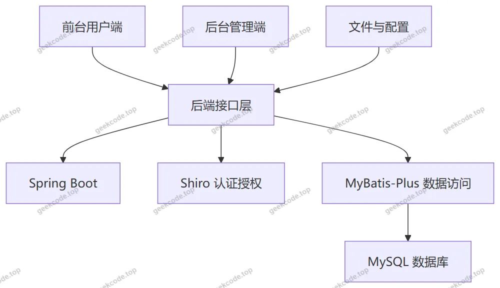</a>

<h3>数据库设计要点</h3>

根据现有 Controller、后台路由与截图功能，可确认系统围绕以下核心业务对象组织数据：用户、商品分类、商品信息、商品资讯、购物车、地址、订单、收藏、商品信息评论、商品评价、客服聊天、系统配置、文件资源。

数据库设计要点如下：

<ul>
<li>使用 MySQL 作为业务数据存储，通过 mysql-connector-java 与后端应用连接。</li>
<li>使用 MyBatis-Plus 提供通用 CRUD 能力，减少重复数据访问代码。</li>
<li>商品信息、商品分类、商品资讯分别承载商品展示、分类组织和内容资讯功能。</li>
<li>订单模块存在 <code>/orders/:status</code> 路由，说明订单数据至少需要状态区分，用于不同订单阶段的管理与查看。</li>
<li>收藏、评论、评价、购物车、地址等模块与用户和商品信息存在业务关联。</li>
<li>客服聊天模块由 ChatController 与 <code>/chat</code> 路由支撑，用于用户沟通信息的管理。</li>
<li>配置文件由 ConfigController 与 <code>/config</code> 路由支撑，用于系统基础参数维护。</li>
<li>FileController 表明系统存在文件处理能力，可用于图片、附件等资源访问，但具体文件表结构根据现有信息无法确定。</li>
<li>具体数据表字段、主键、外键、索引设计根据现有信息无法确定。</li>
</ul>
<h3>核心技术选型理由</h3>
<ul>
<li>Spring Boot：基于 spring-boot-starter-web、spring-boot-starter-jdbc 等依赖，可快速构建 Web 应用与数据访问层，降低配置复杂度。</li>
<li>MyBatis-Plus：相比原生 MyBatis 更适合常规增删改查场景，可提升业务开发效率。</li>
<li>Shiro：使用 shiro-spring 完成认证与授权控制，满足前台登录、后台管理等权限场景。</li>
<li>MySQL：使用 mysql-connector-java 作为数据库驱动，适合中小型业务系统的数据持久化。</li>
<li>validation-api：依赖中包含参数校验基础能力，可用于接口入参校验，具体校验规则根据现有信息无法确定。</li>
<li>commons-lang3：提供通用工具类支持，减少基础代码重复。</li>
<li>protobuf-java：作为依赖组件存在，具体业务用途根据现有信息无法确定。</li>
</ul>
<h2>功能模块</h2>
<h3>前台用户端</h3>
<table>
<thead>
<tr>
<th>模块</th>
<th>功能描述</th>
</tr>
</thead>
<tbody><tr>
<td>前台首页</td>
<td>系统入口页面，用于进入前台主要业务模块。</td>
</tr>
<tr>
<td>前台登录</td>
<td>用户身份认证入口，登录后可访问个人中心相关功能。</td>
</tr>
<tr>
<td>前台注册</td>
<td>用户账号注册入口，用于创建前台使用账号。</td>
</tr>
<tr>
<td>商品信息列表</td>
<td>展示商品基础信息，支持用户浏览商品内容。</td>
</tr>
<tr>
<td>商品信息详情</td>
<td>展示单个商品的详细信息。</td>
</tr>
<tr>
<td>商品分类列表</td>
<td>展示商品分类信息，便于按分类浏览商品。</td>
</tr>
<tr>
<td>商品分类详情</td>
<td>展示单个分类的详细信息。</td>
</tr>
<tr>
<td>商品资讯列表</td>
<td>展示商品资讯内容，用于信息发布与浏览。</td>
</tr>
<tr>
<td>商品资讯详情</td>
<td>展示单篇商品资讯的详细内容。</td>
</tr>
<tr>
<td>购物车列表</td>
<td>展示购物车数据，支持用户查看已加入购物车的商品。</td>
</tr>
<tr>
<td>我的订单列表</td>
<td>展示用户订单数据，支持按订单状态查看。</td>
</tr>
<tr>
<td>我的地址列表</td>
<td>展示用户地址数据，支持地址管理。</td>
</tr>
<tr>
<td>我的收藏列表</td>
<td>展示用户收藏的商品或内容信息。</td>
</tr>
<tr>
<td>商品信息评论列表</td>
<td>展示商品信息相关评论数据。</td>
</tr>
<tr>
<td>商品信息评论详情</td>
<td>展示单条评论的详细内容。</td>
</tr>
<tr>
<td>商品评价列表</td>
<td>展示商品评价数据。</td>
</tr>
<tr>
<td>商品评价详情</td>
<td>展示单条评价的详细内容。</td>
</tr>
<tr>
<td>客服聊天</td>
<td>前台客服沟通入口，用于用户咨询。</td>
</tr>
<tr>
<td>个人中心</td>
<td>用户个人信息与业务数据入口，包含我的订单、我的地址、我的收藏等菜单。</td>
</tr>
</tbody></table>
<h3>后台管理端</h3>
<table>
<thead>
<tr>
<th>模块</th>
<th>对应路由或控制器</th>
<th>功能描述</th>
</tr>
</thead>
<tbody><tr>
<td>后台登录</td>
<td>admin 登录页</td>
<td>管理员身份认证入口。</td>
</tr>
<tr>
<td>后台首页</td>
<td>admin 首页</td>
<td>后台管理入口页面，用于进入各管理模块。</td>
</tr>
<tr>
<td>用户管理</td>
<td><code>/yonghu</code>、AddressController 等用户相关接口</td>
<td>管理前台用户相关数据。</td>
</tr>
<tr>
<td>商品信息管理</td>
<td><code>/shangpinxinxi</code>、ShangpinxinxiController</td>
<td>管理商品信息数据。</td>
</tr>
<tr>
<td>商品分类管理</td>
<td><code>/shangpinfenlei</code>、ShangpinfenleiController</td>
<td>管理商品分类数据。</td>
</tr>
<tr>
<td>商品资讯管理</td>
<td><code>/news</code>、NewsController</td>
<td>管理商品资讯内容。</td>
</tr>
<tr>
<td>订单管理</td>
<td><code>/orders/:status</code>、OrdersController</td>
<td>管理订单数据，支持按状态查看或处理。</td>
</tr>
<tr>
<td>商品信息评论管理</td>
<td><code>/discussshangpinxinxi</code>、DiscussshangpinxinxiController</td>
<td>管理商品信息评论数据。</td>
</tr>
<tr>
<td>商品评价管理</td>
<td><code>/shangpinpingjia</code>、ShangpinpingjiaController</td>
<td>管理商品评价数据。</td>
</tr>
<tr>
<td>我的收藏管理</td>
<td><code>/storeup</code>、Storeup 相关接口</td>
<td>管理用户收藏数据。</td>
</tr>
<tr>
<td>客服管理</td>
<td><code>/chat</code>、ChatController</td>
<td>管理客服聊天数据。</td>
</tr>
<tr>
<td>配置文件管理</td>
<td><code>/config</code>、ConfigController</td>
<td>管理系统配置参数。</td>
</tr>
<tr>
<td>文件处理</td>
<td>FileController</td>
<td>提供文件相关处理能力，当前截图未体现独立管理页面。</td>
</tr>
<tr>
<td>通用接口</td>
<td>CommonController</td>
<td>提供通用业务支撑能力，具体功能根据现有信息无法确定。</td>
</tr>
</tbody></table>
<h2>用户角色与权限</h2>
<h3>普通用户</h3>

普通用户通过前台登录、注册页面进入系统，可访问前台首页与个人中心相关功能。根据前台导航菜单、个人中心菜单与截图功能，普通用户权限包括：

<ul>
<li>浏览商品信息、商品分类、商品资讯。</li>
<li>查看商品详情、分类详情、资讯详情。</li>
<li>查看购物车列表。</li>
<li>查看我的订单列表，并按订单状态访问订单数据。</li>
<li>查看和管理我的地址列表。</li>
<li>查看我的收藏列表。</li>
<li>查看商品信息评论列表与评论详情。</li>
<li>查看商品评价列表与评价详情。</li>
<li>进入客服聊天页面。</li>
<li>访问个人中心。</li>
</ul>

普通用户是否具备商品评论、商品评价、订单提交、购物车结算等完整操作权限，根据现有信息无法确定。

<h3>管理员</h3>

管理员通过后台登录页进入后台管理端，可访问后台路由对应的管理功能。根据后台路由与截图，管理员权限包括：

<ul>
<li>用户管理。</li>
<li>商品信息管理。</li>
<li>商品分类管理。</li>
<li>商品资讯管理。</li>
<li>订单管理。</li>
<li>商品信息评论管理。</li>
<li>商品评价管理。</li>
<li>我的收藏管理。</li>
<li>客服管理。</li>
<li>配置文件管理。</li>
</ul>

管理员是否可进入前台购物流程，以及是否可进一步细分角色权限，根据现有信息无法确定。

<h3>客服角色</h3>

系统存在客服聊天与后台客服管理功能，但当前上下文未明确独立客服账号、客服权限或客服后台角色配置。是否存在独立客服角色，根据现有信息无法确定。

<h2>项目特色与创新点</h2>
<ul>
<li>覆盖网上超市基础业务闭环：包含商品展示、商品分类、商品资讯、购物车、订单查看、地址管理、收藏、评论、评价和客服聊天等模块。</li>
<li>商品反馈机制分层：商品信息评论与商品评价分别通过独立 Controller 和独立后台路由管理，形成不同维度的用户反馈数据。</li>
<li>订单状态化管理：后台订单路由采用 <code>/orders/:status</code> 形式，支持按订单状态组织管理入口。</li>
<li>用户个人数据集中：个人中心包含我的订单、我的地址、我的收藏等菜单，便于用户统一管理个人业务数据。</li>
<li>客服沟通入口：前台提供客服聊天页面，后台提供客服管理入口，形成咨询与管理基础能力。</li>
<li>系统配置化：通过 ConfigController 与 <code>/config</code> 路由提供配置文件管理能力，便于维护系统基础参数。</li>
<li>技术整合完整：后端使用 Spring Boot、MyBatis-Plus、Shiro、MySQL 等常见 Java Web 技术栈，适合毕业设计场景下的工程实现与展示。</li>
<li>文件处理能力：FileController 表明系统具备文件处理相关接口能力，可用于图片、附件等资源支撑。</li>
</ul>
<h2>部署环境</h2>
<table>
<thead>
<tr>
<th>环境组件</th>
<th>用途</th>
<th>版本要求</th>
</tr>
</thead>
<tbody><tr>
<td>JDK</td>
<td>运行 Spring Boot 后端应用</td>
<td>具体版本根据现有信息无法确定</td>
</tr>
<tr>
<td>MySQL</td>
<td>存储业务数据</td>
<td>具体版本根据现有信息无法确定</td>
</tr>
<tr>
<td>Node.js</td>
<td>前端构建与依赖管理</td>
<td>具体版本根据现有信息无法确定</td>
</tr>
<tr>
<td>Spring Boot 内嵌 Web 容器</td>
<td>提供 HTTP 接口服务</td>
<td>具体容器类型根据现有信息无法确定</td>
</tr>
<tr>
<td>MySQL JDBC 驱动</td>
<td>后端连接 MySQL 数据库</td>
<td>依赖项为 mysql-connector-java，具体版本根据现有信息无法确定</td>
</tr>
<tr>
<td>MyBatis-Plus</td>
<td>数据访问与通用 CRUD</td>
<td>依赖项存在，具体版本根据现有信息无法确定</td>
</tr>
<tr>
<td>Shiro</td>
<td>认证与授权</td>
<td>依赖项为 shiro-spring，具体版本根据现有信息无法确定</td>
</tr>
<tr>
<td>项目构建工具</td>
<td>管理 Java 依赖与打包运行</td>
<td>具体构建工具根据现有信息无法确定</td>
</tr>
<tr>
<td>微信开发者工具</td>
<td>小程序或微信端开发运行</td>
<td>当前上下文未体现相关功能，是否需要根据现有信息无法确定</td>
</tr>
</tbody></table>
<h2>五、技术特性</h2>
<ul>
<li>前后端集成部署，前端资源打包至后端 static 目录</li>
<li>使用 MyBatis-Plus 简化数据访问层开发</li>
<li>集成 Shiro 权限框架实现角色权限控制</li>
</ul>
<h2>六、功能模块截图</h2>
<h3>前台用户端</h3>
<h4>前台首页</h4>

<h4>前台登录页</h4>

<a href="https://geekcode.top/archives/%E5%9F%BA%E4%BA%8ESpringBoot%E7%BD%91%E4%B8%8A%E8%B6%85%E5%B8%82%E7%9A%84%E8%AE%BE%E8%AE%A1%E4%B8%8E%E5%AE%9E%E7%8E%B0?utm_source=github" title="查看完整源码">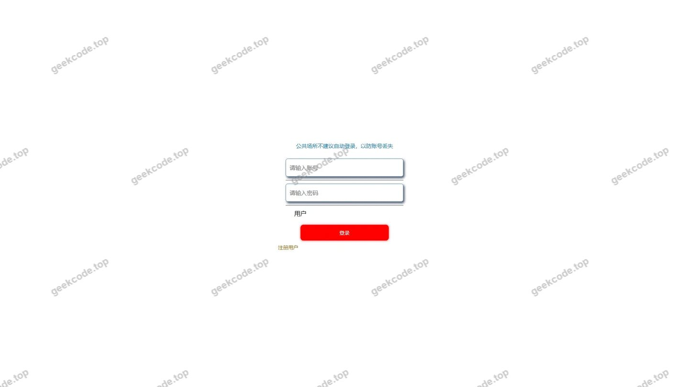</a>

<h4>前台注册页</h4>

<h4>前台-商品资讯列表</h4>

<h4>前台-商品信息列表</h4>

<h4>前台-商品信息评论列表</h4>

<h4>前台-商品评价列表</h4>

<h4>前台个人中心</h4>

<h4>前台-我的地址列表</h4>

<h4>前台-我的订单列表</h4>

<h4>前台-我的收藏列表</h4>

<h4>前台-商品资讯-详情</h4>

<h4>前台-商品信息-详情</h4>

<h4>前台-商品分类列表</h4>

<h4>前台-购物车列表</h4>

<h4>前台-商品信息评论-详情</h4>

<a href="https://geekcode.top/archives/%E5%9F%BA%E4%BA%8ESpringBoot%E7%BD%91%E4%B8%8A%E8%B6%85%E5%B8%82%E7%9A%84%E8%AE%BE%E8%AE%A1%E4%B8%8E%E5%AE%9E%E7%8E%B0?utm_source=github" title="查看完整源码">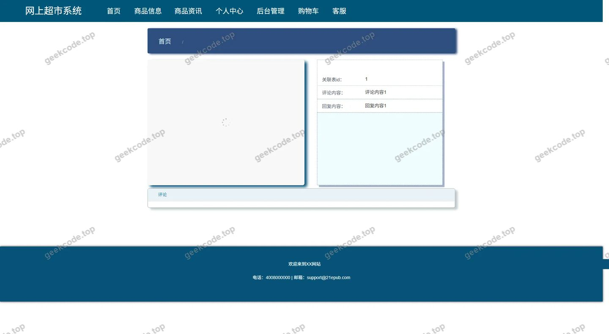</a>

<h4>前台-商品分类-详情</h4>

<a href="https://geekcode.top/archives/%E5%9F%BA%E4%BA%8ESpringBoot%E7%BD%91%E4%B8%8A%E8%B6%85%E5%B8%82%E7%9A%84%E8%AE%BE%E8%AE%A1%E4%B8%8E%E5%AE%9E%E7%8E%B0?utm_source=github" title="查看完整源码">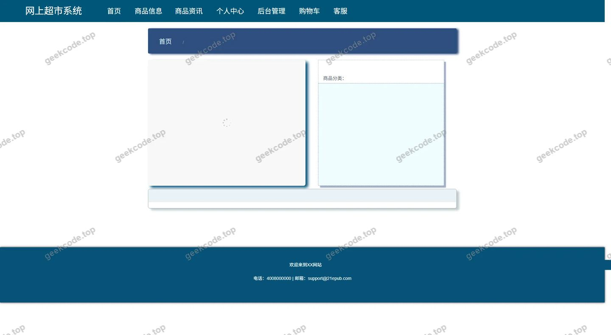</a>

<h4>前台-商品评价-详情</h4>

<a href="https://geekcode.top/archives/%E5%9F%BA%E4%BA%8ESpringBoot%E7%BD%91%E4%B8%8A%E8%B6%85%E5%B8%82%E7%9A%84%E8%AE%BE%E8%AE%A1%E4%B8%8E%E5%AE%9E%E7%8E%B0?utm_source=github" title="查看完整源码">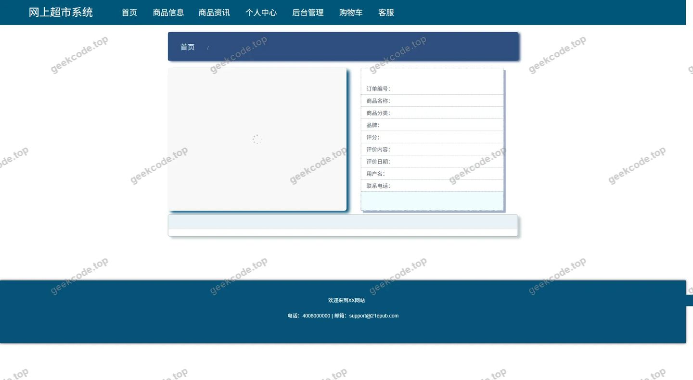</a>

<h4>前台-客服聊天</h4>

<h3>后台管理端</h3>
<h4>后台-在线客服</h4>

<a href="https://geekcode.top/archives/%E5%9F%BA%E4%BA%8ESpringBoot%E7%BD%91%E4%B8%8A%E8%B6%85%E5%B8%82%E7%9A%84%E8%AE%BE%E8%AE%A1%E4%B8%8E%E5%AE%9E%E7%8E%B0?utm_source=github" title="查看完整源码">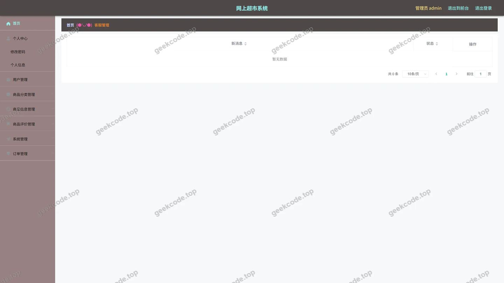</a>

<h4>后台-系统配置</h4>

<a href="https://geekcode.top/archives/%E5%9F%BA%E4%BA%8ESpringBoot%E7%BD%91%E4%B8%8A%E8%B6%85%E5%B8%82%E7%9A%84%E8%AE%BE%E8%AE%A1%E4%B8%8E%E5%AE%9E%E7%8E%B0?utm_source=github" title="查看完整源码">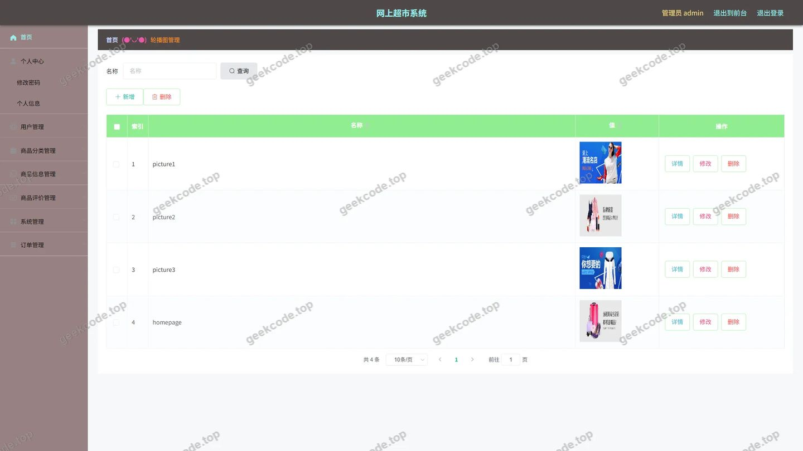</a>

<h4>后台-商品信息评论</h4>

<a href="https://geekcode.top/archives/%E5%9F%BA%E4%BA%8ESpringBoot%E7%BD%91%E4%B8%8A%E8%B6%85%E5%B8%82%E7%9A%84%E8%AE%BE%E8%AE%A1%E4%B8%8E%E5%AE%9E%E7%8E%B0?utm_source=github" title="查看完整源码">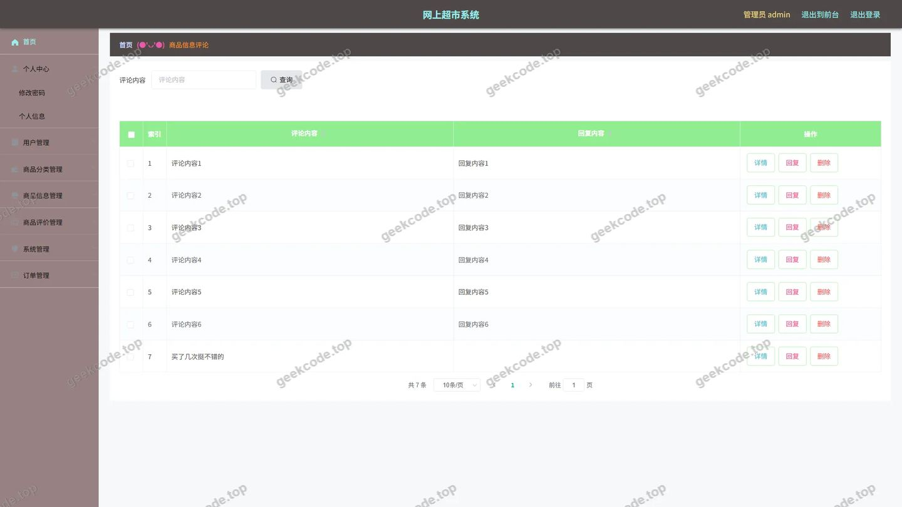</a>

<h4>后台首页</h4>

<a href="https://geekcode.top/archives/%E5%9F%BA%E4%BA%8ESpringBoot%E7%BD%91%E4%B8%8A%E8%B6%85%E5%B8%82%E7%9A%84%E8%AE%BE%E8%AE%A1%E4%B8%8E%E5%AE%9E%E7%8E%B0?utm_source=github" title="查看完整源码">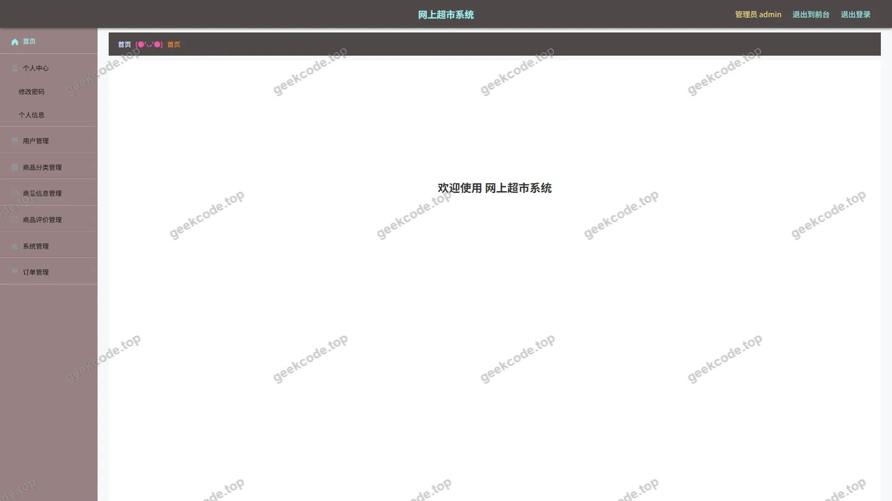</a>

<h4>后台-登录</h4>

<a href="https://geekcode.top/archives/%E5%9F%BA%E4%BA%8ESpringBoot%E7%BD%91%E4%B8%8A%E8%B6%85%E5%B8%82%E7%9A%84%E8%AE%BE%E8%AE%A1%E4%B8%8E%E5%AE%9E%E7%8E%B0?utm_source=github" title="查看完整源码">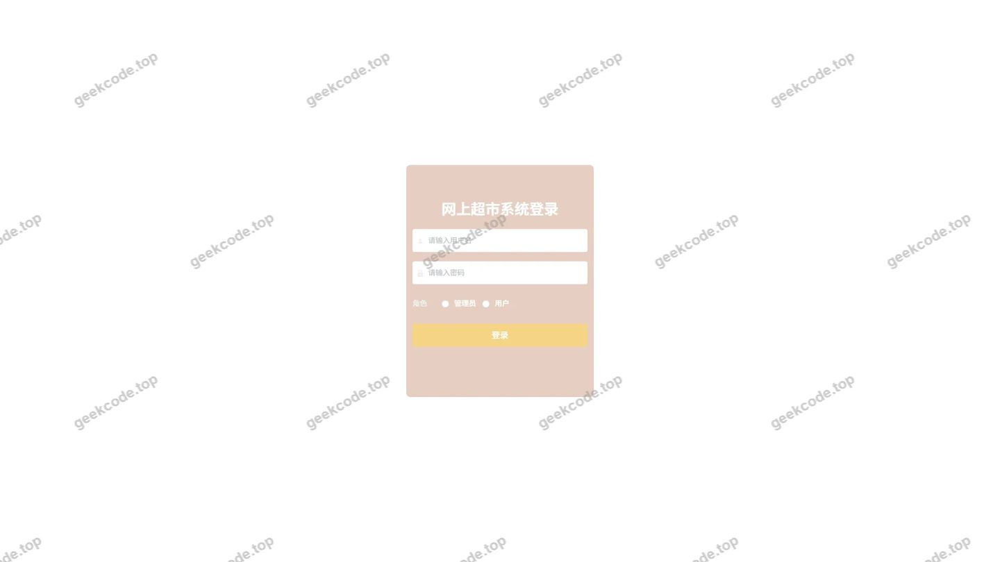</a>

<h4>后台-公告信息</h4>

<a href="https://geekcode.top/archives/%E5%9F%BA%E4%BA%8ESpringBoot%E7%BD%91%E4%B8%8A%E8%B6%85%E5%B8%82%E7%9A%84%E8%AE%BE%E8%AE%A1%E4%B8%8E%E5%AE%9E%E7%8E%B0?utm_source=github" title="查看完整源码">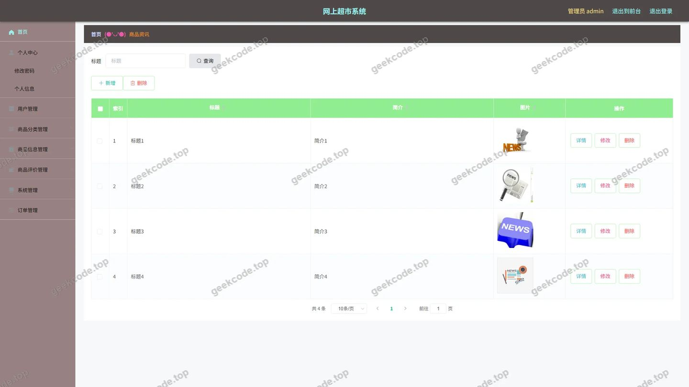</a>

<h4>后台-订单-状态</h4>

<a href="https://geekcode.top/archives/%E5%9F%BA%E4%BA%8ESpringBoot%E7%BD%91%E4%B8%8A%E8%B6%85%E5%B8%82%E7%9A%84%E8%AE%BE%E8%AE%A1%E4%B8%8E%E5%AE%9E%E7%8E%B0?utm_source=github" title="查看完整源码">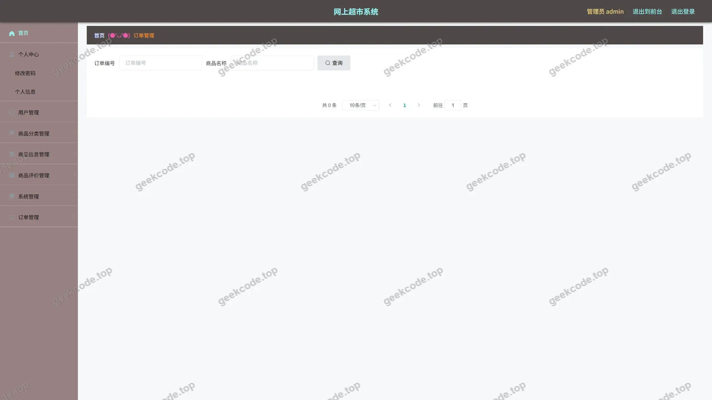</a>

<h4>后台-商品分类</h4>

<a href="https://geekcode.top/archives/%E5%9F%BA%E4%BA%8ESpringBoot%E7%BD%91%E4%B8%8A%E8%B6%85%E5%B8%82%E7%9A%84%E8%AE%BE%E8%AE%A1%E4%B8%8E%E5%AE%9E%E7%8E%B0?utm_source=github" title="查看完整源码">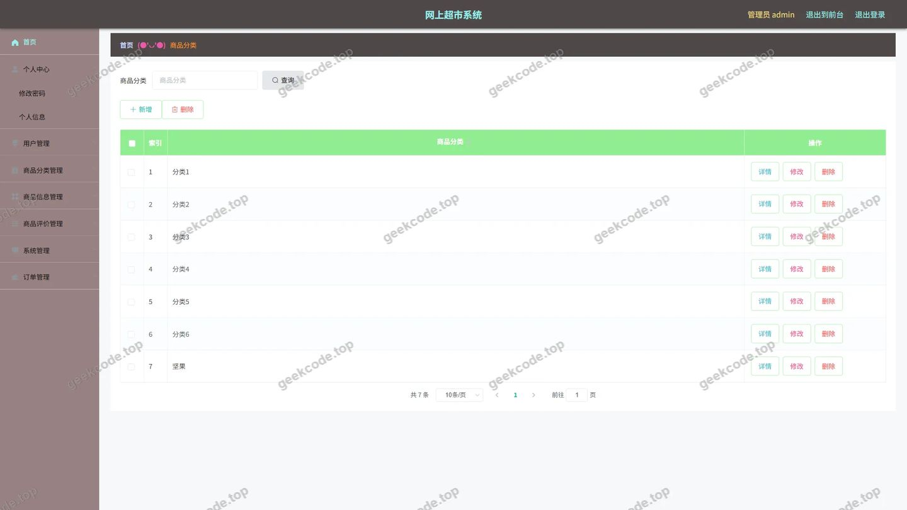</a>

<h4>后台-商品评价</h4>

<a href="https://geekcode.top/archives/%E5%9F%BA%E4%BA%8ESpringBoot%E7%BD%91%E4%B8%8A%E8%B6%85%E5%B8%82%E7%9A%84%E8%AE%BE%E8%AE%A1%E4%B8%8E%E5%AE%9E%E7%8E%B0?utm_source=github" title="查看完整源码">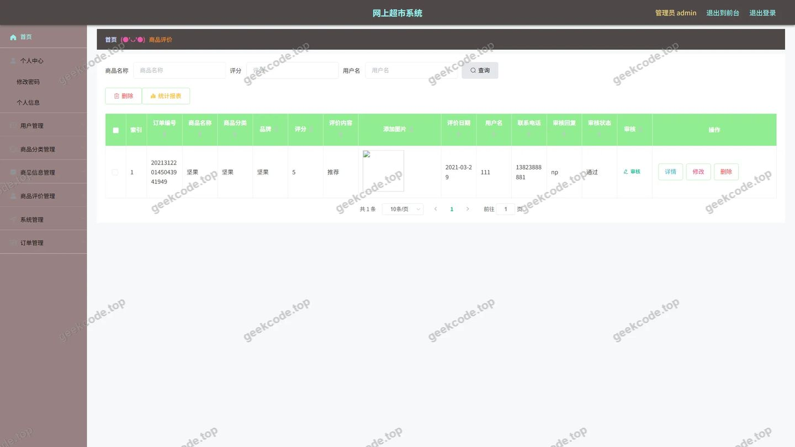</a>

<h4>后台-商品信息</h4>

<a href="https://geekcode.top/archives/%E5%9F%BA%E4%BA%8ESpringBoot%E7%BD%91%E4%B8%8A%E8%B6%85%E5%B8%82%E7%9A%84%E8%AE%BE%E8%AE%A1%E4%B8%8E%E5%AE%9E%E7%8E%B0?utm_source=github" title="查看完整源码">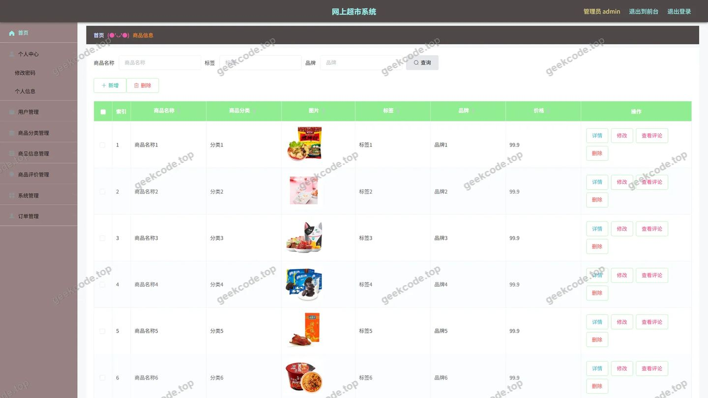</a>

<h4>后台-收藏</h4>

---

## 获取完整源码

| 项目 | 说明 |
| --- | --- |
| 项目名 | 基于SpringBoot网上超市的设计与实现 |
| 运行截图 | 本文 31 张（站点带水印原图，仓库 `images/` 目录） |
| 完整源码 | [https://geekcode.top/archives/%E5%9F%BA%E4%BA%8ESpringBoot%E7%BD%91%E4%B8%8A%E8%B6%85%E5%B8%82%E7%9A%84%E8%AE%BE%E8%AE%A1%E4%B8%8E%E5%AE%9E%E7%8E%B0?utm_source=github](https://geekcode.top/archives/%E5%9F%BA%E4%BA%8ESpringBoot%E7%BD%91%E4%B8%8A%E8%B6%85%E5%B8%82%E7%9A%84%E8%AE%BE%E8%AE%A1%E4%B8%8E%E5%AE%9E%E7%8E%B0?utm_source=github) |
| 咨询微信 | **ir9372**（备注：jingpin-yuanma） |
| 更多项目 | [极客代码 geekcode.top](https://geekcode.top/?utm_source=github) |

> 需要源码、部署、改配置、跑不起来等问题，加微信 ir9372 沟通，说明项目名即可。
